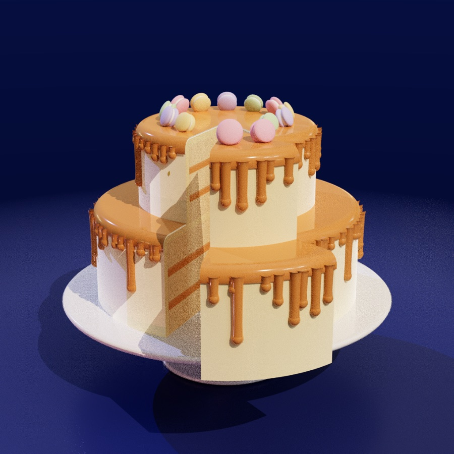
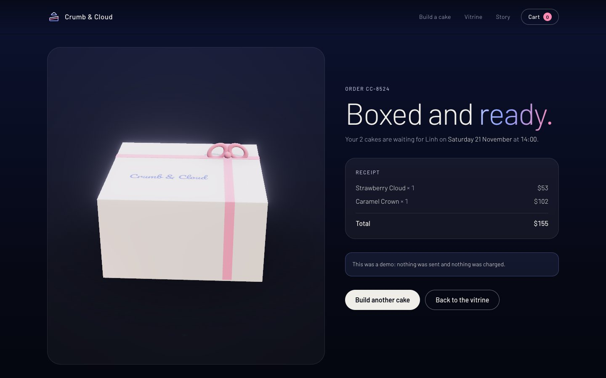
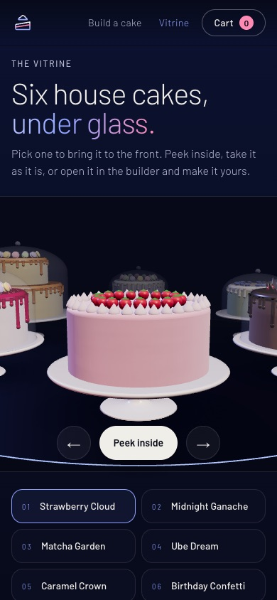

# Crumb & Cloud

A demo bakery that shows what real-time 3D on the web looks like: design a layer cake, slice it, box it up.
Not a real shop.

**Live demo (planned URL):** https://bakery-3d.vercel.app


## What it does

- **Home** (`/`): a scroll story. The camera dives into the cake chapter by chapter, a slice slides out to show
  the layers, the glaze pours again and the toppings land. A side index jumps between chapters.
- **Cake builder** (`/design`): size, sponge, filling, frosting, drip, up to four toppings, candles and a
  message on a chocolate plaque. Every choice redraws the cake in 3D and updates the price. Slice it to check
  the layers, save a picture, or develop a path-traced "studio photo" on a desktop, then add it to the cart.
- **Vitrine** (`/menu`): six house cakes on a turning table under glass cloches. The chosen cake comes to the
  front and its cloche lifts. Take it as it is, or open it in the builder.
- **Cart** (`/cart`): quantities, a demo checkout (pickup name, day and time; no payment details), and a
  closing scene where the cake is lowered into a box that folds itself shut and gets a ribbon.



| Builder, sliced                                                                                       | Vitrine                                                                     | Boxed up                                                                                      |
| ----------------------------------------------------------------------------------------------------- | --------------------------------------------------------------------------- | --------------------------------------------------------------------------------------------- |
|  |  |  |




## How it is built

### A cake made of code

There is not a single 3D model file. Each cake is generated from the customer's choices:

- **Frosting:** a `LatheGeometry` turned from a profile with a rounded top edge, with a buttercream texture
  painted on a canvas and used as a bump map.
- **The slice:** the cake is built as two pieces that fit exactly, the body and a wedge. "Slicing" moves the
  wedge out. Its cut faces are `ShapeGeometry` with the sponge, filling and crumbs painted live on a canvas in
  the chosen flavours, reused as a bump map so the cut catches the light.
- **Drips, sprinkles, piped cream:** `InstancedMesh`, so a hundred drips cost two draw calls. Placement comes
  from a random generator seeded with the design, so the same design always looks the same.
- **Details:** flickering candle flames, a chocolate plaque with the message written in Pacifico (drei `Text`,
  from a 66 KB Latin and Vietnamese subset of the 329 KB font), porcelain stands, glass cloches and the folding
  cake box, all from primitives.

### Scroll-driven story

The scroll position becomes a continuous chapter number (2.5 is halfway between chapters 2 and 3). One frame
loop damps the camera between per-chapter shots, shifts the view to make room for the text on wide screens, and
drives the slice, glaze and toppings through a small controls object instead of React state, so scrolling
never re-renders the tree. Lenis smooths the scroll unless the visitor asked for reduced motion.

### Quality and performance

- Every scene goes through one `CanvasShell`: a WebGL check with a 2D fallback, an error boundary, rendering
  paused while the canvas is off screen, and a capped device pixel ratio.
- Two quality tiers. Phones and machines with four cores or fewer start on "low"; drei's `PerformanceMonitor`
  moves any device down if the frame rate drops.
- The "high" tier adds an HDRI from a real café for reflections, shadow maps and post-processing: N8AO
  ambient occlusion, bloom on the candle flames, a vignette and ACES tone mapping.
- Floor shadows are a soft radial texture painted once, not `ContactShadows`: they cost nothing per frame and
  do not show the shadow plane's edge through the effect chain.
- Scenes load with `next/dynamic` and `ssr: false`; every page is prerendered as static HTML.

### Pictures

"Save picture" and the cart thumbnails draw the frame again through the effect composer and copy it in the same
task, so the picture matches the screen without turning on `preserveDrawingBuffer`.

### Studio photo (path tracing)

On a desktop, "Studio photo" hands the builder's canvas to
[three-gpu-pathtracer](https://github.com/gkjohnson/three-gpu-pathtracer), which refines the frame sample by
sample (256 per pixel) while a progress bar fills, then offers a 1200 px PNG:

- The live scene is copied into a still one the path tracer understands: instanced drips and sprinkles are
  baked into plain geometry with per-instance colours as vertex colours, and the message (troika text, drawn
  by its own shader) is repainted in Pacifico on a plane.
- It is lit by the café HDRI itself and set on a studio floor that fades into a night-sky gradient.
- The quality monitor is held while the photo develops, so the deliberate frame-rate drop does not demote the
  device.
- Two workarounds for three r187: the HDRI is passed as an equirect image (the library cannot convert the cube
  environment the live scene uses), and clearcoat is folded into roughness (it renders black otherwise).

### No backend

The cart and the current design live in `localStorage` (zustand `persist`, falling back to memory when storage
is blocked) and are read after the first render, so server and browser HTML match. The checkout validates the
pickup details and stops there: nothing is sent and no payment is taken.

## Accessibility

- Every page works without WebGL: the scenes show a drawing, the welcome screen still opens, and the shop
  still works.
- The vitrine has a plain radio list next to the 3D table; arrow keys move through it.
- Real form controls throughout, a skip link, visible focus, and focus moved to the first invalid field or to
  the confirmation heading.
- With reduced motion: no idle animation, no smooth scrolling, the box scene starts closed.
- All text colour pairs pass WCAG AA (the faintest measures 6.2:1).

## Tech stack

| Area      | Tools                                                                                                            |
| --------- | ---------------------------------------------------------------------------------------------------------------- |
| Framework | Next.js 16.4 (App Router, Turbopack, Cache Components), React 19.3, TypeScript 5.9 (strict)                      |
| 3D        | three.js 0.187, React Three Fiber 9.8, drei 10.7, postprocessing 6.39 with @react-three/postprocessing 3.2, N8AO |
| UI        | Tailwind CSS 4.3, Lenis 1.3, zustand 5.1, Barlow and Barlow Condensed via `next/font`                            |
| Tests     | Vitest 5.1 (pricing, cart, order rules), Playwright 1.65 (end-to-end, desktop and phone)                         |
| CI        | GitHub Actions: typecheck, lint, format, unit tests, build, end-to-end tests                                     |

Dependency versions are pinned exactly in `package.json`.

## Run locally

Requires Node.js 20.9 or later and pnpm 10 (`corepack enable` picks the version from `package.json`).

```bash
pnpm install
pnpm dev                  # http://localhost:3000
pnpm check                # typecheck, lint, format check, unit tests, production build
pnpm build && pnpm e2e    # end-to-end tests against the production build
```

## Project structure

```
src/app/                    routes: / (story), /design, /menu, /cart
src/components/three/       CanvasShell, lighting, effects, capture, shadows
src/components/three/cake/  the procedural cake: geometry, layout, toppings
src/components/three/scenes story, builder, vitrine and box scenes
src/components/{home,design,menu,cart}/  page UI
src/lib/                    cake options and pricing, presets, cart, order rules, store, unit tests
e2e/                        Playwright tests
scripts/screenshot.mjs      screenshots with a real GPU
```

## Credits

Light from Poly Haven (CC0), fonts under the SIL Open Font License. Full list in [CREDITS.md](CREDITS.md).
Made by [Kiệt Nguyễn](https://kietnguyen.io.vn).

## License

The code is released under the [MIT License](LICENSE).
