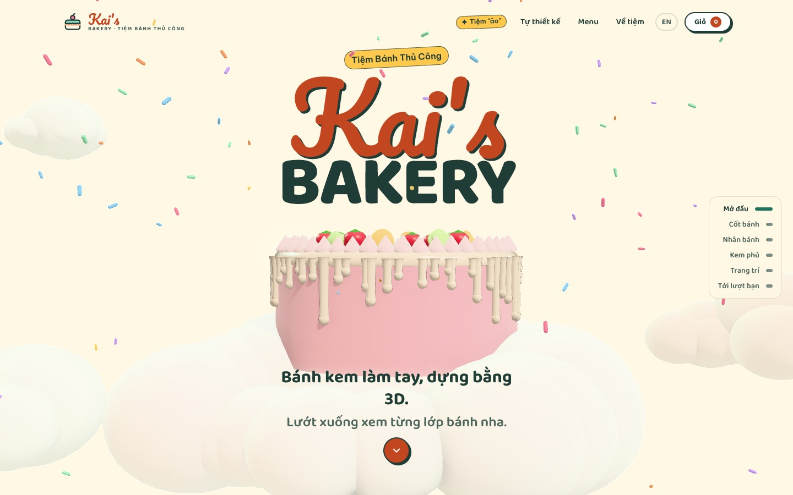
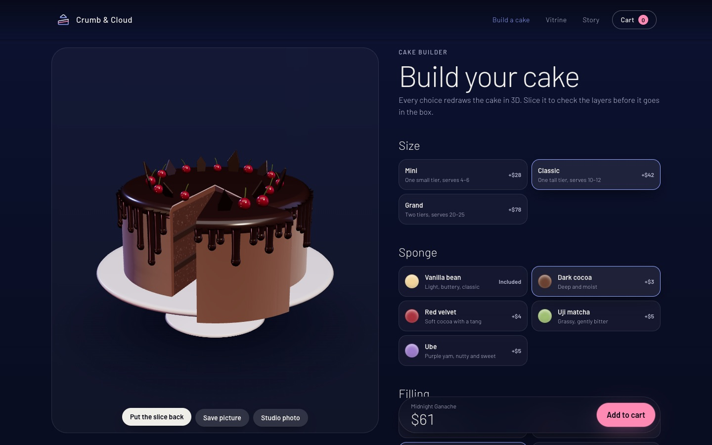
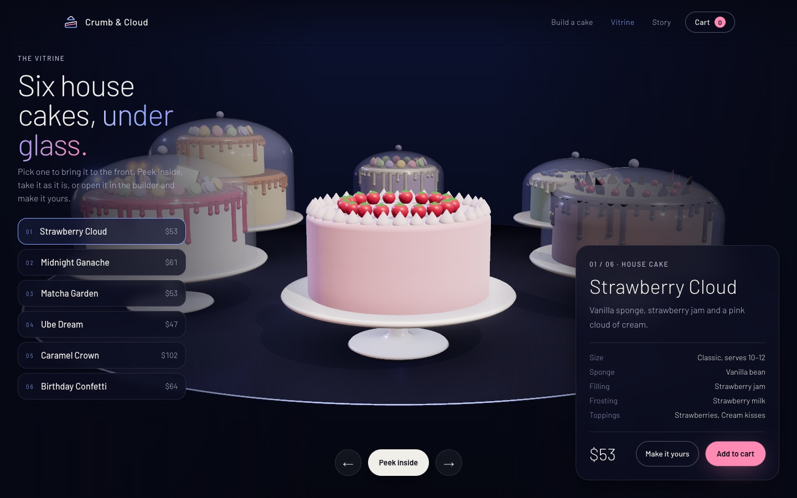
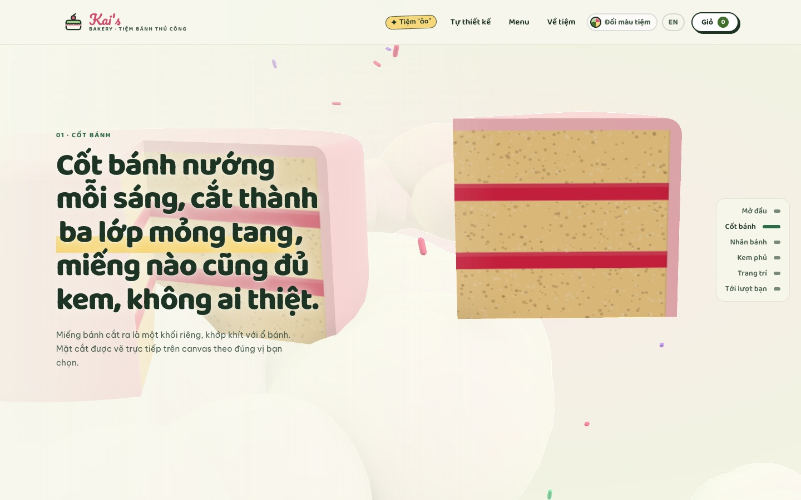
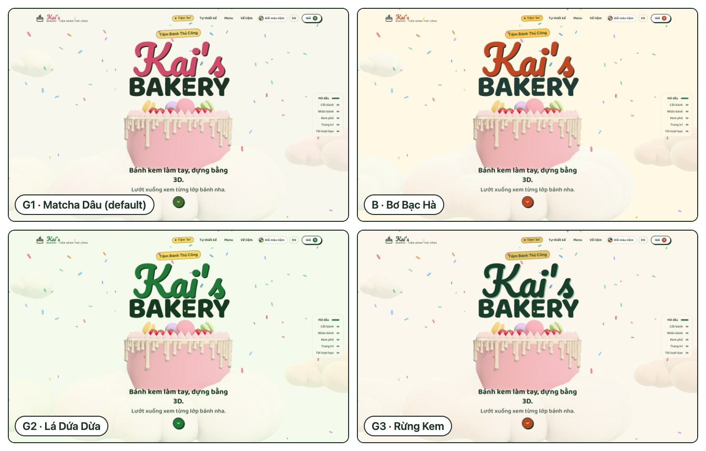

# Kai's Bakery – Tiệm Bánh Thủ Công

A cake shop website built to show what real-time 3D on the web can do in 2026: design a layer cake in 3D,
slice it to see the layers, and watch it get boxed up. Vietnamese by default, with an English version.

**Live: [bakery.kaidev.io.vn](https://bakery.kaidev.io.vn)** (English at [/en](https://bakery.kaidev.io.vn/en))

**Kai's Bakery is not a real shop.** It is a web project by Kai. The cakes, prices and policies are
realistic on purpose, but no order is ever sent and nobody is charged; every page says so.

> Tiếng Việt: Kai's Bakery là dự án web minh họa của Kai, tiệm không có thật. Trang mặc định bằng tiếng
> Việt, có bản tiếng Anh ở `/en`. Bạn có thể tự thiết kế bánh 3D, cắt bánh xem ruột, đặt thử một đơn (không đơn
> nào được gửi đi).



## What it does

- **Home** (`/`): a scroll story in five chapters. The camera moves around the cake, a slice slides out to
  show the sponge and filling, the glaze pours over the edge and the toppings land. Under the story: why the
  shop, the six house cakes (pictures taken from the 3D scene itself) and how ordering works in three steps. The welcome screen lets you in at once;
  the scene finishes loading behind it, and the opening act waits until the cake is on screen.
- **Cake builder** (`/design`): start from one of the six house cakes or from scratch: size in centimetres (10 cm bento to two tiers), sponge, filling, frosting,
  drip, up to four toppings, sweetness, candles and a message of up to 22 characters with full Vietnamese
  diacritics. Every choice redraws the cake and the price in đồng, and shows how far ahead it must be ordered.
  On phones a bar under the stage jumps between the groups of choices. Slice it, save a picture, develop a path-traced studio photo on a desktop, or copy a link that opens the
  exact same cake (`/design#cake=…`, in the fragment so it never reaches a server) to send to the shop on Zalo.
- **Vitrine** (`/menu`): the six house cakes on a turning table under glass cloches. The chosen cake comes to
  the front and its cloche lifts. Add it as it is, or open it in the builder.
- **Cart** (`/cart`): quantities, then a demo checkout in two steps (who and how, then when and how to pay):
  pickup at the shop or delivery, chips for the next seven open days, time slots in the shop's own time zone,
  lead times, holiday rules and a 50% deposit where the policy needs one. A cake in the cart can be reopened in the
  builder and put back in its own line. It ends with
  the cake being lowered into a box that folds shut and gets a ribbon.
- **About, policies, FAQ**: the story of the (imaginary) shop and of the project, ordering, payment,
  cancellation, storage and allergy policies, and 13 questions answered.

| Builder, sliced                                                                             | Vitrine                                                                     | Boxed up                                                                           |
| ------------------------------------------------------------------------------------------- | --------------------------------------------------------------------------- | ---------------------------------------------------------------------------------- |
|  |  |  |




### Four colour sets

A switch in the header recolours the whole shop, 3D scenes included, and the browser remembers the choice.

| Set                           | Feel                                                          |
| ----------------------------- | ------------------------------------------------------------- |
| **G1 · Matcha Dâu** (default) | matcha milk and strawberry: soft greens, a strawberry "Kai's" |
| **B · Bơ Bạc Hà**             | butter and mint, the first palette: a peach-orange buy button |
| **G2 · Lá Dứa Dừa**           | pandan and coconut: the freshest green                        |
| **G3 · Rừng Kem**             | forest and cream: deep green ink and logo                     |



## How it is built

### Two languages, one set of pages

- Every page lives under `src/app/[lang]` and is prerendered for `vi` and `en`. Each language's words are a chunk of
  their own (`src/i18n/Words.tsx`), without the long policy and FAQ pages, which only the server renders.
- `src/proxy.ts` keeps Vietnamese without a prefix: `/menu` is rewritten to `/vi/menu`, `/vi/menu`
  redirects (308) to `/menu`, and `/en/menu` is served as it is. Each page has one address per language,
  a canonical link and `hreflang` alternates; the sitemap lists both.
- The words live in typed dictionaries (`src/i18n/vi/*.ts`, `src/i18n/en/*.ts`). The English dictionary is
  typed from the Vietnamese one, so a missing string is a type error.
- The cake model (`src/lib/cake.ts`) holds no words at all: sizes in centimetres, prices in đồng, allergens
  as codes. Names and descriptions come from the dictionary.

### A cake made of code

There is not a single 3D model file. Each cake is generated from the customer's choices:

- **Frosting:** a `LatheGeometry` turned from a profile with a rounded top edge, with a buttercream texture
  painted on a canvas and used as a bump map.
- **The slice:** the cake is built as two pieces that fit exactly, the body and a wedge. "Slicing" moves the
  wedge out. Its cut faces are painted live on a canvas in the chosen flavours, then reused as a bump map so
  the cut catches the light.
- **Drips, sprinkles, piped cream:** `InstancedMesh`, so a hundred drips cost two draw calls. Placement comes
  from a random generator seeded with the design, so the same design always looks the same.
- **Sizes:** the cake is modelled in centimetres; small cakes are framed closer and their toppings, candles
  and plaque scale with them.
- **Details:** candle flames, a plaque with the message written in Pacifico (a Latin and Vietnamese subset of
  the font), porcelain stands, glass cloches and the folding cake box, all from primitives. Every scene colour
  comes from one theme file (`src/components/three/theme.ts`).

### Scroll-driven story

The scroll position becomes a continuous chapter number (2.5 is halfway between chapters 2 and 3), worked out on
scroll only, from section positions measured when they change size. The canvas's frame loop damps the camera between per-chapter shots and drives the slice, glaze and toppings through a small
controls object instead of React state, so scrolling never re-renders the tree. Lenis smooths the scroll
unless the visitor asked for reduced motion.

### Motion

- **The cake answers every choice.** A new frosting or glaze colour eases in over 420 ms; a new size grows or
  shrinks the cake from the one on screen (560 ms, settling with a hint of give) while the camera glides to
  the new framing; toppings and candles drop in one after another; fresh glaze runs down from each tier's
  edge. The builder's canvas renders on demand, so these frames run only while something moves.
- **Each kind of decoration has its own random stream**, so a new colour or message never shuffles the
  sprinkles, and adding fruit leaves the macarons where they stood.
- **Pictures show the finished cake:** saving a picture, adding to the cart or starting a studio photo jumps
  every running tween to its end first.
- **Pages:** React `<ViewTransition>` fades the old page out quickly and lets the new one rise in; the header
  stays put. The language switch (a full page load) fades with a cross-document view transition, and a new
  colour set cross-fades the whole page. Lenis smooths wheel scrolling on every page; on the builder the
  wheel zooms the cake instead.
- **Controls:** buttons press down fast and spring back, choice cards lift, prices tick to the new total, the
  cart badge bumps when something is added. One set of easing tokens (`--ease-out`, `--ease-spring`) in
  `globals.css`.

### Quality and performance

- Every scene goes through one `CanvasShell`: a WebGL check with a 2D fallback, an error boundary, rendering
  paused while the canvas is off screen, and a capped device pixel ratio.
- Two quality tiers. Phones and machines with four cores or fewer start on "low"; drei's `PerformanceMonitor`
  moves any device down if the frame rate drops.
- Reflections get a bright horizon the colour of the page. Seen at a low angle, glaze mirrors what lies behind it,
  and that was the black of an empty cube: white chocolate turned grey-brown and every drip wore a dark outline.
- The "high" tier adds an HDRI from a real café for reflections, shadow maps and post-processing: N8AO
  ambient occlusion, a soft bloom and neutral tone mapping, which keeps the pastel colours true.
- The builder renders on demand: with the cake standing still it draws nothing (it used to draw about 13,700
  calls every 3 s on a desktop). Every frame comes back only while candles burn or a studio photo develops. A
  scene on demand draws continuously for its first 3 s so the frame-rate monitor can judge the device, and the
  monitor is off while frames are sparse (they would read as a slow machine).
- Asked for less motion, the story and the box draw on demand as well: nothing at all while the page stands still.
- The vitrine renders on demand too: its slow idle turn draws 30 frames a second, anything the visitor moves gets
  every frame, toppings stay out of the floor reflection, and closed cakes skip their cut faces (about a third of
  the old cost). The café light fades in when it arrives instead of brightening the scene in one jump.
- The cart page sends its empty state from the server and swaps in the skeleton before the first paint when the
  saved cart holds cakes, so nothing shifts as it loads.
- `node scripts/vitals.mjs <url> 3 / /design /menu /cart` measures loading on an emulated mid-range phone
  (Lighthouse's mobile throttling: 4x CPU, 150 ms, 1.6 Mbps) with Playwright: FCP, LCP, CLS, long tasks, bytes.
- Scenes load with `next/dynamic` and `ssr: false`; every page is prerendered as static HTML.

### Four palettes without a flash

- `src/lib/palettes.ts` is the only place colours are defined: four sets of the same 22 roles (ink and muted
  carry text, leaf is links and focus, buy is only for buying, brand is the "Kai's" script, the rest is
  decoration). `globals.css` holds the default set in `@theme` so Tailwind knows the tokens; a test keeps the
  two equal.
- The root layout writes one `:root[data-palette="…"]` rule per set and a tiny inline script that applies the
  saved set before the first paint, so pages stay static HTML and never flash the default colours.
- Shadows, background blobs, selection and focus rings are mixed from the tokens (`color-mix`), and the
  background sprinkles are drawn per set.
- The 3D scenes read the same set: switching recolours the live scene (sky, light tints, table, box ribbon and
  print) without a reload, and saved pictures use the chosen sky.

### Studio photo (path tracing)

On a desktop, "Studio photo" hands the builder's canvas to
[three-gpu-pathtracer](https://github.com/gkjohnson/three-gpu-pathtracer), which refines the frame sample by
sample while a progress bar fills, then offers a PNG. It is lit by the café HDRI alone, like a soft box.
Instanced drips and sprinkles are baked into plain geometry first, and the message is repainted on a plane,
because the path tracer cannot read either directly. It uses the Sobol sampler: the library's default left a
fixed maze pattern on diffuse surfaces that more samples did not clear.

### Ordering rules, without a backend

- Lead times: 4 hours for a house cake, 24 hours for a cake designed on the site, 48 hours for two tiers and
  for holidays. Same-day house cakes must be ordered before 18:00.
- Time is always the shop's (Asia/Ho_Chi_Minh), not the visitor's device, so someone abroad ordering for
  family in Vietnam still sees the right slots.
- Two tiers, orders from 1,000,000 đ and holiday orders take a 50% deposit by bank transfer or MoMo, rounded
  up to the thousand (and the checkout says so). The holidays are New Year's Day, Valentine's Day (14/2),
  Women's Day (8/3), Children's Day (1/6), Vietnamese Women's Day (20/10), Teachers' Day (20/11), Christmas Eve
  and Christmas; the week before Tết and its first three days count too.
- The cart and the current design live in `localStorage` (zustand `persist`) and are read after the first
  render, so server and browser HTML match. The checkout validates the form and stops there: one switch in
  `src/lib/shop.ts` (`ORDERING_OPEN`) keeps it a demo.

All of these rules have unit tests (`src/lib/*.test.ts`).

## Accessibility

- Every page works without WebGL: the scenes show a drawing, the welcome screen still opens, and the shop
  still works.
- The vitrine has a plain radio list next to the 3D table; arrow keys move through it.
- Real form controls throughout, a skip link, visible focus, and focus moved to the first invalid field, to
  each checkout step's heading or to the confirmation heading.
- The one-time hints (drag to turn the cake, what the colour dot does) are for the eyes only: never in the way
  of a click, hidden from screen readers, shown once per browser.
- With reduced motion: no idle animation, no smooth scrolling, the box scene starts closed, and changes to
  the cake or the page happen at once (fades stay, movement goes).
- Every text colour pair passes WCAG AA in all four colour sets, and a unit test measures them again
  (`src/lib/contrast.test.ts`). The colour switch is a keyboard-friendly radio group.

## Tech stack

| Area      | Tools                                                                                                            |
| --------- | ---------------------------------------------------------------------------------------------------------------- |
| Framework | Next.js 16.4 (App Router, Turbopack, Cache Components, `proxy.ts`), React 19.3, TypeScript 5.9 (strict)          |
| 3D        | three.js 0.187, React Three Fiber 9.8, drei 10.7, postprocessing 6.39 with @react-three/postprocessing 3.2, N8AO |
| UI        | Tailwind CSS 4.3, Lenis 1.3, zustand 5.1; Baloo 2, Be Vietnam Pro and Pacifico                                   |
| Tests     | Vitest 5.1 (pricing, lead times, orders, share links, colour contrast), Playwright 1.65 (desktop and phone)      |
| CI        | GitHub Actions: typecheck, lint, format, unit tests, build, end-to-end tests                                     |

Dependency versions are pinned exactly in `package.json`.

## Run locally

Requires Node.js 22.12 or later (Vitest needs it; the site alone runs on 20.9) and pnpm 10 (`corepack enable` picks
the version from `package.json`). CI uses Node 22.

```bash
pnpm install
pnpm dev                  # http://localhost:3000 (Vietnamese), /en for English
pnpm check                # typecheck, lint, format check, unit tests, production build
pnpm build && pnpm e2e    # end-to-end tests against the production build
```

Canonical links, the sitemap and the social preview image (`public/og/`, one per language) use
`https://bakery.kaidev.io.vn`. To deploy a fork or a preview under another address, set `NEXT_PUBLIC_SITE_URL`.

## Project structure

```
src/proxy.ts                Vietnamese without a prefix, English under /en
src/app/[lang]/             pages: / (story), /design, /menu, /cart, /about, /policies, /faq
src/i18n/{vi,en}/           typed dictionaries, one file per area
src/components/three/       CanvasShell, lighting, effects, capture, theme
src/components/three/cake/  the procedural cake: geometry, layout, toppings
src/components/three/scenes story, builder, vitrine and box scenes
src/components/{home,design,menu,cart,info}/  page UI
src/lib/                    cake model and prices, presets, lead times, cart, order rules, share links, shop details
e2e/                        Playwright tests
scripts/                    screenshots with a real GPU, the house cakes' pictures, README pictures, loading metrics
```

## Credits

Light from Poly Haven (CC0), fonts under the SIL Open Font License. Full list in [CREDITS.md](CREDITS.md).
Made by [Kai](https://kietnguyen.io.vn).

## License

The code is released under the [MIT License](LICENSE).
